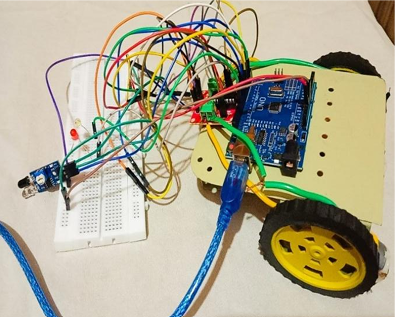
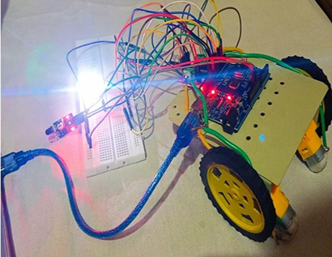

# 🚗 Driver Drowsiness Detection System

An Arduino-based embedded system designed to detect driver drowsiness using an IR eye blink sensor and provide alerts to improve driving safety.

## 📌 Project Overview

Driver fatigue and drowsiness can affect driving performance and increase the risk of road accidents. This project monitors eye activity using an IR eye blink sensor and activates an alert mechanism when prolonged eye closure is detected.

## 🎯 Objectives

- Detect prolonged eye closure using an IR eye blink sensor.
- Monitor the driver's eye activity.
- Reduce vehicle motor speed when drowsiness is detected.
- Activate visual and audio alerts.

## ⚙️ Components Used

- Arduino Uno
- IR Eye Blink Sensor
- L293D Motor Driver
- DC Motors
- LEDs
- Buzzer
- Robot chassis and wheels

## 🔧 Working Principle

1. The IR eye blink sensor monitors the driver's eye state.
2. Arduino reads the sensor output.
3. When prolonged eye closure is detected, the system identifies a drowsiness condition.
4. The motor driver is used to gradually reduce motor speed and stop the motors.
5. LEDs and a buzzer provide alerts.

## 💻 Technologies Used

- Arduino
- Embedded C/C++
- IR Sensors
- Motor Control
- L293D Motor Driver

## 📄 Project Documentation

The complete project report is available here:

[View Project Report](driver%20drowsiness%20project.pdf)

## 💻 Source Code

[View Arduino Source Code](drowsiness_detection.ino)

## 🚀 Future Improvements

- Integrate a camera-based eye-tracking system.
- Implement real-time drowsiness monitoring.
- Add GPS and emergency notification features.
- Improve detection accuracy.

---

## 📸 Project Demonstration

### 1. Normal Driving Condition (Driver Awake)

### 2. Drowsiness Detected

## 👨‍💻 Author

**Shrey Sharma**

B.Tech – Electronics and Communication Engineering  
Jaypee Institute of Information Technology, Noida

[GitHub](https://github.com/shrey4602) | [LinkedIn](https://www.linkedin.com/in/shrey-sharma-9779a6294)
